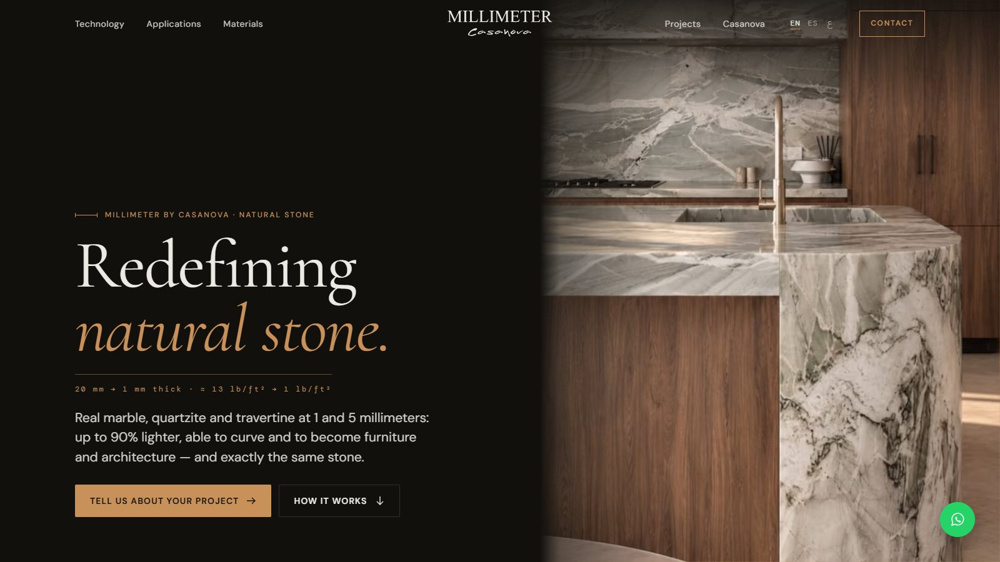
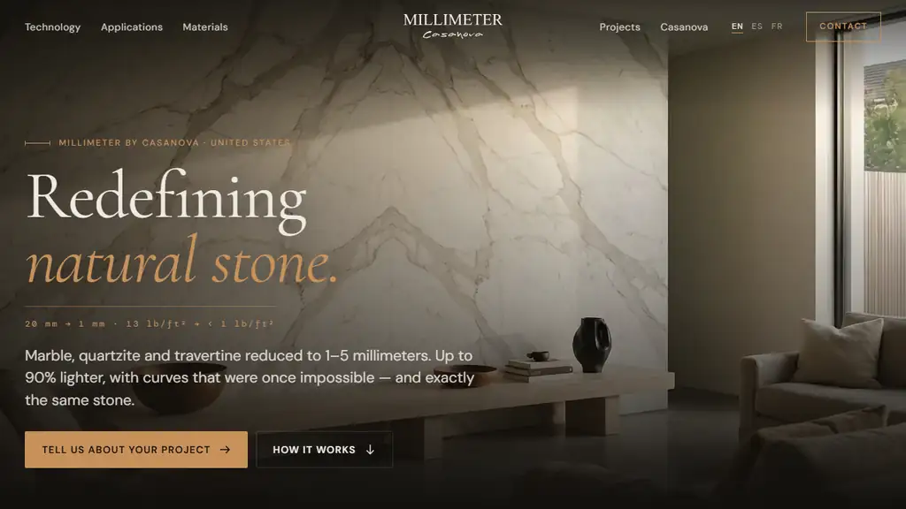
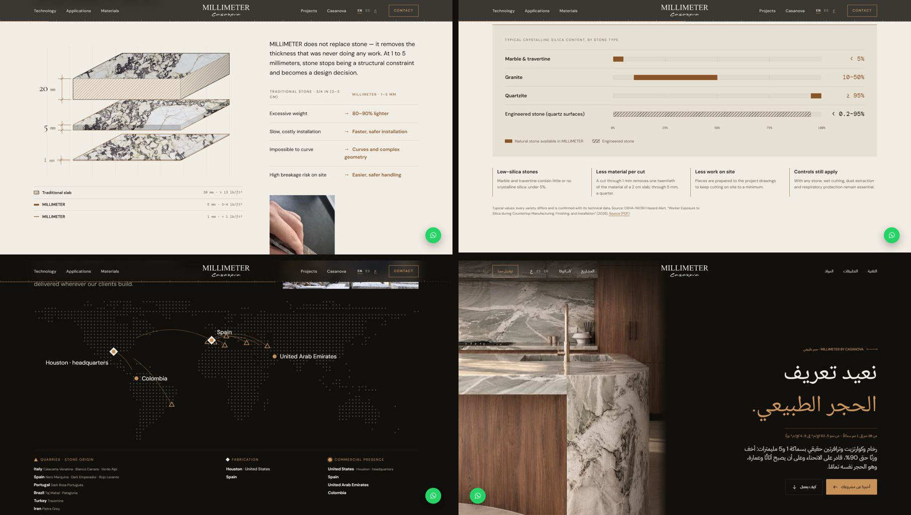
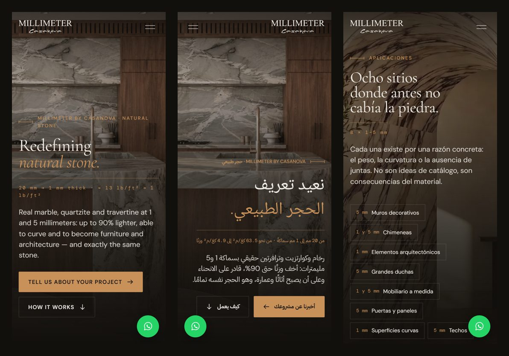
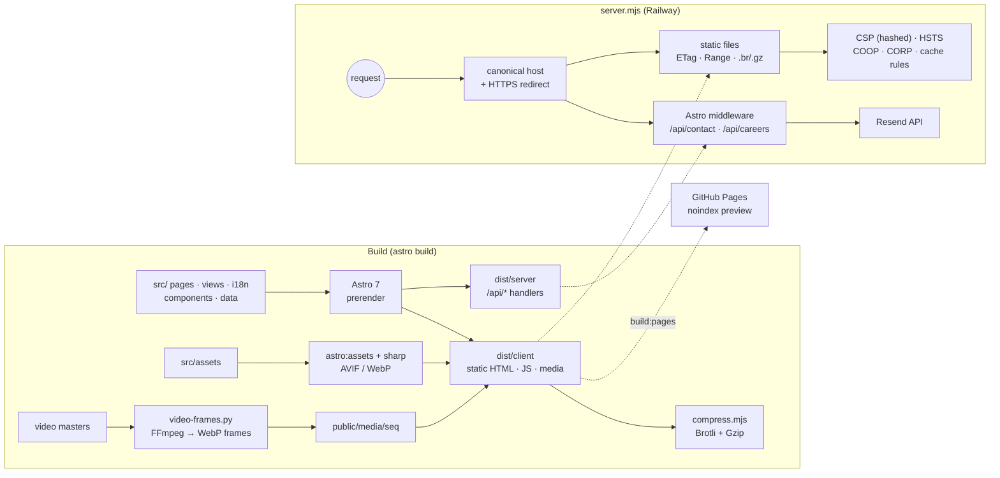

<div align="center">



# MILLIMETER by Casanova

**The global website of a natural-stone brand — marble, quartzite and travertine at 1 and 5 mm — in English, Spanish and right-to-left Arabic.**
<br/>Scroll-driven video, architectural data visualisation, editorial typography and a hardened Node edge, built to load fast and rank well.

[](https://kin9zeus.github.io/Millimeter-USA/)
&nbsp;
[](https://github.com/Kin9Zeus/Millimeter-USA/actions/workflows/ci.yml)


</div>

---

## Overview

The parent site of **MILLIMETER by Casanova**, a company that slices real natural stone down to 1 and 5 mm so it can go on curved walls, ceilings, doors and furniture, with commercial presence in the United States, Spain, the United Arab Emirates and Colombia. The brief asked for a luxury, image-led experience with motion on every page. It also had to be fast, accessible, secure, verifiable in every technical claim, and easy to find in classic search engines and AI answer engines.

The result is a static-first Astro site: every page is prerendered to HTML, and only the two form endpoints run on the server. On top of that sits a motion layer that turns short video clips into frame sequences you scrub with the scroll wheel, plus a small custom Node server that adds the security, caching and compression that hosting platforms don't give you by default.

<div align="center">
  
  <br/><sub>Hero video scrubbed by the scroll, not autoplayed: it moves only when the visitor moves.</sub>
</div>

## Highlights

| | |
|---|---|
| 🎞️ **Scroll-driven video** | Page heroes are ≤ 6 s clips, exported as WebP frame sequences (16:9 desktop and 9:16 mobile crops) and painted on a `<canvas>` by a GSAP ScrollTrigger scrub. There are no autoplaying or looping videos, frames load coarse-to-fine, and the mobile variant is chosen per aspect ratio. Portrait photography gets a **split hero** instead of being upscaled into a wide frame. |
| 📐 **Architectural data visuals** | An axonometric shop drawing of three volumes of the same stone at true relative thickness (20 : 5 : 1), with real stone texture and section hatching, that opens up on scroll; a silica range chart built as an accessible table, with figures and a source link from the OSHA–NIOSH Hazard Alert; and a dotted Natural Earth world map of quarries, workshops and markets, generated at build time into a single SVG path. |
| ⚡ **Performance first** | The pages are prerendered HTML. AVIF/WebP images come out of `astro:assets` + sharp, fonts are self-hosted and preloaded, and text is precompressed with Brotli and Gzip. The motion bundle waits for the first paint or the first interaction, and `content-visibility` skips work for off-screen sections. |
| 🌍 **Trilingual i18n with RTL** | English, Spanish and Arabic with typed dictionaries that share one shape, localized slugs (`/technology`, `/es/tecnologia`, `/ar/technology`) and `hreflang` clusters on every page. Arabic ships right-to-left: `dir="rtl"`, logical CSS properties, mirrored arrows, motion and progress bars, Naskh + Plex Sans Arabic loaded only for Arabic glyphs, and no letter-spacing or synthetic italics that would break the script. Units follow the reader: imperial first in English, metric only in Spanish and Arabic. |
| 🔎 **SEO + GEO** | A JSON-LD graph per page (Organization, LocalBusiness, Person, WebSite, WebPage, Breadcrumb, FAQ, ItemList), a sitemap with alternates, `llms.txt`, and a `robots.txt` that explicitly lets AI search engines read and cite the site. |
| 🛡️ **Hardened edge** | Strict CSP with build-time SHA-256 hashes of inline scripts, plus HSTS, COOP/CORP, Permissions-Policy and canonical-host and HTTPS redirects. Path-traversal-safe static serving with ETag + Range support for iOS media. |
| ♿ **Accessible motion** | Built to WCAG 2.2 AA, with skip links, visible focus, labelled controls and AA contrast. Animation runs by default, a footer switch turns it off for the visitor (remembered across visits), and the site falls back to the still version on Save-Data or 2G connections. |
| 💬 **Contact that never gets in the way** | A floating WhatsApp button in brand green on every page. It lifts above the cookie notice, steps aside while a form field has focus, and tucks into the margin whenever text or a control is underneath, so it never covers content. Every WhatsApp control uses the same AA-contrast green style. |
| ✉️ **Forms without a database** | Contact and careers forms work without JavaScript and are enhanced when it loads. They are protected by a honeypot, a minimum fill time, rate limiting, same-origin checks and PDF validation, and sent through the Resend HTTP API. |
| 🔁 **Two deploy targets, one codebase** | The full build runs on Railway (Node). A static, `noindex` client preview runs on GitHub Pages, where the base path comes from `PUBLIC_SITE_URL`. |

## Screenshots

<div align="center">
  
  <br/><br/>
  
</div>

## Lighthouse

Lab scores for the production build (`npm run build && npm start`):

| Page | Device | Performance | Accessibility | Best Practices | SEO |
|---|---|:-:|:-:|:-:|:-:|
| Home | Desktop | **100** | **100** | **100** | **100** |
| Technology | Desktop | **100** | **100** | **100** | **100** |
| Home (Arabic, RTL) | Desktop | **99** | **100** | **100** | **100** |
| Home | Mobile | **95** | **100** | **100** | **100** |
| Home (Spanish) | Mobile | **95** | **100** | **100** | **100** |
| Technology (Arabic) | Mobile | **90** | **100** | **100** | **100** |

## Architecture



### How the scroll video works

1. **Master clip (≤ 6 s).** `scripts/video-frames.py` trims and denoises the clip, then exports 40–72 frames as WebP in two crops: 1280 px at 16:9 for desktop, and 640 px at 9:16 for mobile, with a per-page focal point.
2. **Build-time manifest.** `MediaHero.astro` counts the frames on disk while building and writes the counts to the `<canvas>` as data attributes, so the browser never has to look them up.
3. **Runtime.** `sequence.ts` loads frames in a coarse-to-fine order (first, last, then every 16th, 8th, 4th… frame), so scrubbing works before everything has arrived. It draws with cover-fit and a DPR cap, and ScrollTrigger maps scroll progress to a frame index.
4. **Graceful fallback.** A still poster is always in the markup. Without JavaScript, with animation switched off or on Save-Data, the visitor sees that image instead of the sequence.

## Project structure

```text
src/
├─ pages/            thin routes per locale (EN at root, /es, /ar) · sitemap.xml · robots.txt · llms.txt · api/*
├─ views/            one view per page, rendered for any locale
├─ components/       Header, Footer, MediaHero, WorldMap, WhatsAppFloat, Icon, Form, CookieNotice, sections/*, legal/*
├─ i18n/             en.ts · es.ts · ar.ts (typed, same shape) · routes.ts (localized slugs, text direction, base path)
├─ layouts/          Base.astro: SEO, JSON-LD graph, hreflang, deferred motion layer
├─ scripts/          main.ts (GSAP/Lenis motion layer) · sequence.ts (canvas frame player)
├─ lib/              schema.ts (JSON-LD builders) · server/forms.ts (validation, rate limit, Resend)
├─ data/             materials catalog · media registry · sites (map) · world-dots (generated)
└─ styles/           global.css: design tokens, fluid type scale, motion modes
public/              icons, manifest, security.txt, motion-mode.js, media/seq/<page>/{d,m}
scripts/             compress.mjs · make-icons.mjs · pages-prepare.mjs · process-media.py · video-frames.py · world-map.mjs
server.mjs           production server: static + API + security headers + redirects
```

## Getting started

```bash
npm install
cp .env.example .env      # PUBLIC_SITE_URL=http://localhost:4321
npm run dev               # http://localhost:4321
```

| Script | What it does |
|---|---|
| `npm run dev` | Astro dev server with HMR |
| `npm run build` | Production build plus Brotli/Gzip precompression |
| `npm start` | Runs `server.mjs` on `:8080` (static files, API, security headers) |
| `npm run check` | `astro check`: type-checks `.astro` and `.ts` |
| `npm run build:pages` | Static build adapted for GitHub Pages (directory indexes, `.nojekyll`) |
| `npm run frames` | Rebuilds scroll frame sequences from the video masters (needs FFmpeg + Pillow) |
| `npm run media` | Rebuilds the optimized photo set from the raw source folders (metadata stripped, never upscaled) |
| `node scripts/world-map.mjs` | Regenerates the dotted world map from Natural Earth land data |

### Environment

| Variable | Scope | Purpose |
|---|---|---|
| `PUBLIC_SITE_URL` | build | Canonical origin for canonical URLs, hreflang, sitemap and Open Graph. A path in it becomes the base path. |
| `PUBLIC_PREVIEW` | build | `1` = preview build: `noindex`, robots disallow, and forms explain that sending opens at launch. |
| `RESEND_API_KEY` | server | Sends the form emails |
| `CONTACT_TO` / `CONTACT_FROM` | server | Recipient and verified sender |

Secrets are never committed. Production values live only in the hosting provider.

## Deployment

- **Production: Railway.** `railway.json` builds with `npm run build` and starts `node server.mjs`, with a health check on `/api/health`. DNS points the domain at Railway, and the server enforces the canonical host and HTTPS.
- **Preview: GitHub Pages.** `.github/workflows/pages.yml` builds with `PUBLIC_SITE_URL` set to the Pages URL and `PUBLIC_PREVIEW=1` on every push to `main`. Crawlers are kept out until launch.
- **CI.** `.github/workflows/ci.yml` runs the type-check and a production build on every pull request.

## Credits

Design & development by **[@Kin9Zeus](https://github.com/Kin9Zeus)**.

Brand, photography, product data and copy © MILLIMETER by Casanova / MILLIMETER Global LLC. Shown here as a portfolio case study. All rights reserved.
